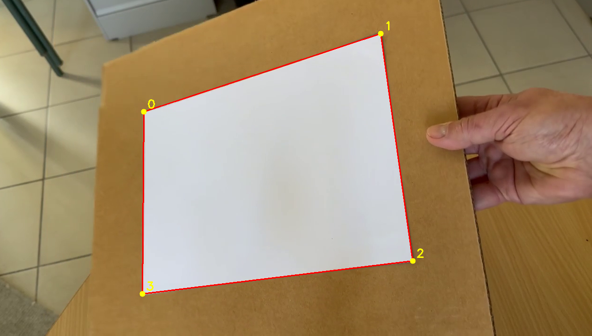

# Réalité Augmentée / Virtuelle / Mixte

Ce repo contient le projet de 5A des matières de Réalité Augmentée/Virtuelle/Mixte et ce fichier Readme vous permettra d'observer son avancement.
Binôme : ANDRIANAMBININTSOA Menjatiana Danih et BONNEMAINS Emilie.

## Première étape : Pipeline de vision

Pour commencer le projet, nous avons utilisé la ressource vidéo mise à notre disposition : input.mp4 

09/10 : Mise en place du contexte OpenGL et OpenCV : affichage et réglages de la fenêtre principale. 
Puis, lecture de la vidéo dans la fenêtre. 

13/09 : Mise en place de la pipeline de vision sur le fichier input.mp4
1. Pré-traitement de la vidéo : transformation en niveau de gris et flou gaussien appliqué
2. Segmentation : application d'un masque binaire en utilisant threshold() avec otsu
3. Géométrie : obtention des contours de la feuille A4 avec findContours(). Puis, étant donné que les contours de la feuille ne sont pas les seuls contours trouvés (autres formes géométriques claires détectées), nous avons calculé les différentes aires formés par ces derniers et avons uniquement gardé la plus grande (qui représente la feuille A4). Nous avons ensuite transformé ce contour en polygone grâce à la fonction approxPolyDP(), avec laquelle on obtient également le vecteur contenant les quatre coins de l'objet. Finalement, on le dessine sur la vidéo avec fillConvexPoly().

Prochaines étapes : Structurer le code, créer des points virtuels et tester la fiabilité du code actuel directement via une caméra ou via d'autres fichiers mp4. 

## Etape 2 : Trouver et trier les coins de la feuille blanche

Une fois qu'on a les points de contours(sous forme de tableau de points), ils sont approximés avec un polygone(ici un quadrilatère).
- La fonction **approxPolyDP** nous permet d'obtenir les 4 coins du quadrilatère.
- Les 4 coins sont ensuite triés par la fonction **sortcorners**.

# Etape 3 : Placer le repère 
